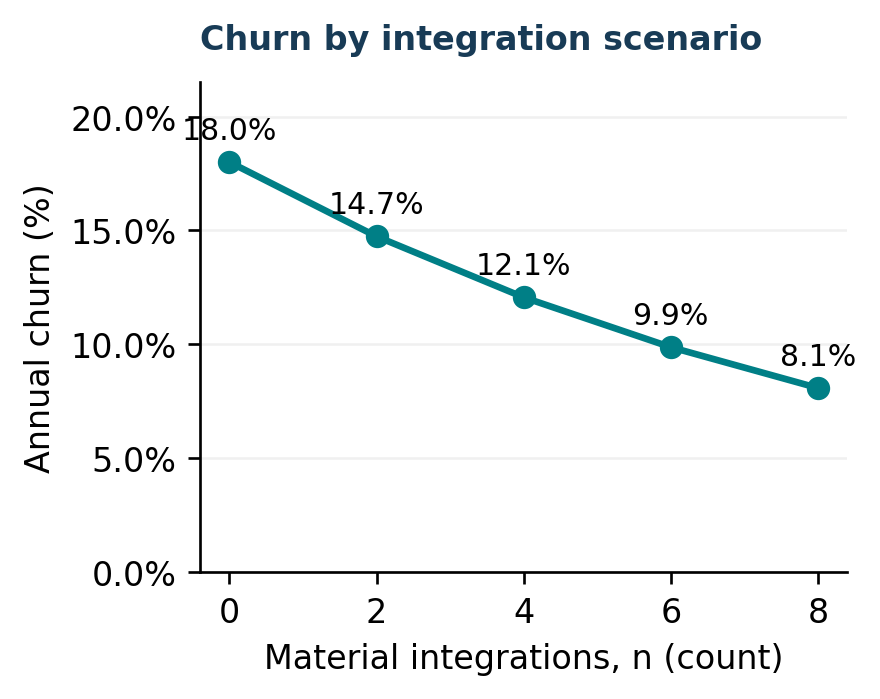
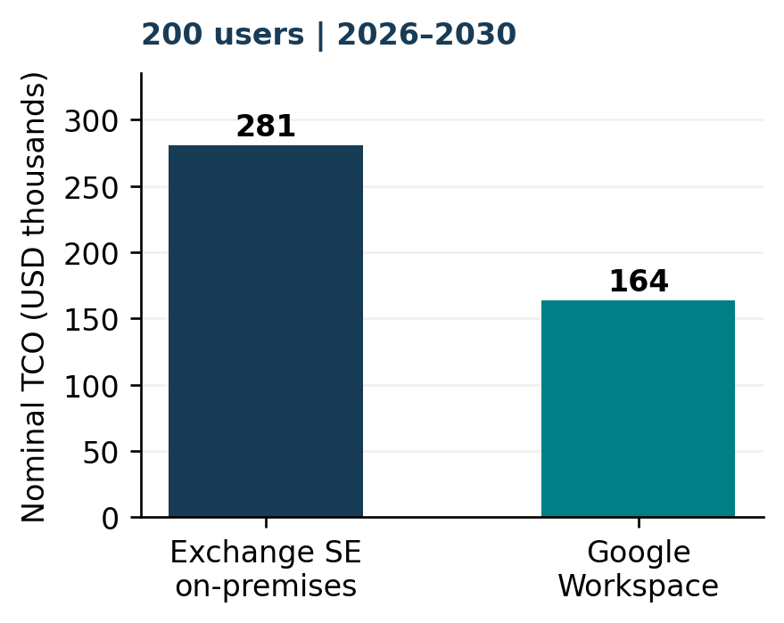

From On-Premises Email to Cloud Platforms: A Strategic and Quantitative Analysis of Microsoft Exchange and Google Workspace

## Executive Summary

For a hypothetical 200-employee SME, Google Workspace has the lower five-year cash cost in the baseline: USD 164,000 versus USD 281,000 for Exchange Server Subscription Edition (SE). The modeled saving is USD 117,000, or 41.6%, over 2026–2030. This is a conditional planning result; it is not an observed saving, a vendor quotation or a recommendation independent of functional requirements.

A standardized supplier-side account model produces five-year risk-adjusted lifetime value (LTV) of USD 17,399 for either option. Against illustrative customer acquisition costs (CAC) of USD 7,000 for Exchange and USD 4,000 for Google, the ratios are 2.49 and 4.35. The difference comes entirely from assumed acquisition-cost allocation, not superior measured Google retention or margins.

The modeled annual churn rate declines from 18.00% at zero integrations to 8.09% at eight. At the baseline of four integrations, churn is 12.07% and five-year end retention is 52.58%. These are outputs of an assumed functional relationship, not customer-cohort estimates.

### Decision in brief

Shortlist Google Workspace for this cost-sensitive case, while obtaining a like-for-like Exchange Online quote and testing migration fidelity, security and governance. Cost leadership is fragile: at USD 14/user/month and only 0.15 Exchange FTE, Exchange SE becomes USD 27,000 cheaper.

<!-- column break -->

## Case Background

The incumbent model places messaging infrastructure under the customer’s operational control. Exchange Mailbox servers store and process mailbox data, with administration through the Exchange admin center and Exchange Management Shell (Microsoft, n.d.-e). For the forward-looking 2026–2030 comparison, the on-premises option is Exchange SE, rather than an assumed deployment of an older server edition (Microsoft, n.d.-f).

Google entered hosted organizational applications in 2006. Its 28 August announcement introduced Google Apps for Your Domain, combining Gmail, Google Talk, Google Calendar and Google Page Creator without customer-installed hardware or software (Google, 2006). This earlier offering provides the historical entry point; the modern comparison uses Google Workspace, not the 2006 bundle.

The present Workspace pricing page describes business email and a wider productivity suite, with differentiated storage, meeting and management capabilities (Google, n.d.-a). Exchange SE primarily anchors this case’s messaging workload. The analysis therefore compares ways to meet a defined SME communications need, rather than asserting that the products contain identical features.

### Scope and evidence

Part A evaluates platform mechanisms and industry structure. Part B1 takes the supplier’s perspective per enterprise account; B2 connects an integration scenario to churn and LTV; B3 takes the SME buyer’s perspective across 200 seats. Customer contribution is not the buyer’s cost saving.

All commercial and behavioral model inputs are explicitly illustrative assumptions. Official documentation supports product and API descriptions; it does not establish actual vendor CAC, churn or market share. Current product pages were checked on 16 October 2026. The Microsoft commercial licensing page still returned HTTP 403; no exact licensing entitlement or price is claimed (Appendix C).

---

## Part A | Strategic Analysis

### Which platform effects matter?

A user ecosystem can create direct coordination value: adoption by colleagues and business partners may make shared calendars, permissions and collaboration easier. However, email interoperability limits the need for external correspondents to use the same supplier. A larger email subscriber count alone is insufficient evidence of a strong proprietary network effect.

Product complementarity is distinct. Email, storage, documents and meetings may be more convenient together than separately; this is an economy of scope or bundle benefit even if the number of users is unchanged. Workspace’s documented bundle illustrates the complement set, but does not measure the incremental value of each component (Google, n.d.-a).

Third-party applications can generate an indirect network effect: more relevant customers attract developers; more useful integrations can then attract customers. Google documents third-party application discovery and installation through Workspace Marketplace (Google, n.d.-b). This establishes a platform channel, not proof of a self-reinforcing growth rate. Microsoft also exposes management and migration capabilities across SE and Exchange Online (Microsoft, n.d.-b; n.d.-c).

Spreading datacenter, engineering or support expenditure over more customers is a supply-side scale economy. It can lower average cost without raising any individual customer’s utility through other users. It should not be counted again as a demand-side network effect.

### Bidirectional switching costs

Leaving Exchange can require mailbox and calendar conversion, permission mapping, identity redesign, application rewrites and staff retraining. Leaving Workspace can similarly require document conversion, sharing-rule reconstruction, OAuth reauthorization and replacement of cloud workflows. Migration commands and API credentials provide concrete reasons for these tasks, but do not quantify their cost (Google, n.d.-c; n.d.-d; n.d.-e; Microsoft, n.d.-c).

<!-- column break -->

### Five Forces comparison matrix

| Force | Traditional on-premises model | Cloud-platform entry |
| --- | --- | --- |
| Rivalry | Installed workflows, control and local service shape competition. | Suite bundling and rapid service updates broaden rivalry. |
| New entrants | Deployment skills and customer infrastructure create entry friction. | Hosted delivery reduces deployment friction; trust and ecosystem depth remain barriers. |
| Buyer power | Custom integrations and sunk setup costs weaken easy switching. | Visible subscriptions aid comparison; data and workflow dependence can weaken later bargaining. |
| Supplier power | Customer depends on hardware, licensing and specialist support. | Some dependence shifts to the platform’s prices, APIs and service terms. |
| Substitutes | Other mail servers or outsourced hosting can meet messaging needs. | Cloud suites and collaboration tools can substitute some workflows, while email remains useful. |

These are directional analytical judgments, not empirical force scores or market-share estimates. Entry changes the location of bargaining power: initial deployment becomes easier, while a mature customer may face greater dependency on identity, data formats and complementary applications.

### The incumbent can also adapt

Microsoft Exchange Online is itself a hosted messaging service, integrated with Microsoft Entra ID (Microsoft, n.d.-d). Its presence prevents a simple “Google cloud versus Microsoft servers” conclusion. An SME with existing Microsoft skills or workflows may prefer Microsoft’s cloud route and avoid part of the cross-vendor conversion burden.

APIs have two effects. Proprietary workflows and permissions can increase rebuilding effort, but documented interfaces and open standards can support extraction and portability. The strategic recommendation is to evaluate workflow depth and exit feasibility together, rather than treating every integration as permanent lock-in.

---

## Part B1 | CAC & Risk-Adjusted LTV

### An explicit cross-subsidy scenario

Assume each supplier acquires 10 enterprise accounts. Exchange incurs USD 70,000 in acquisition spending, giving CAC = 70,000 / 10 = USD 7,000. For Google, assume the same USD 70,000 gross campaign is partly funded by an illustrative USD 30,000 credit from adjacent offerings. Net cost allocated to the focal product is USD 40,000, so net allocated CAC = USD 4,000.

This demonstrates how a diversified entrant could fund acquisition while charging less of the expense to one product. The credit is invented for the exercise; it is not evidence of a Google accounting practice or advertising subsidy. Reusing distribution might also reduce gross acquisition expense, but that separate efficiency is not estimated here.

A funding transfer does not remove real resource use: Google’s gross ecosystem acquisition cost remains USD 7,000 per account in this scenario. Therefore 4.35 is a ratio to net allocated CAC; on a common gross-cost basis both suppliers have a ratio of 2.49. Any claim of superior economic efficiency would need actual incremental cost evidence.

### Comparable contribution and risk

Normalize annual contribution gross profit to USD 6,000 per active enterprise account for both suppliers. Apply a 5% expected operating-risk loss to contribution and a 10% annual discount rate. The loss haircut is distinct from churn and is applied once to each year’s contribution; it is not an extra customer-exit probability.

Use the unrounded B2 baseline c = 0.18 × exp(−0.10 × 4) = 0.1206576083. Equal churn and contribution isolate the assumed CAC difference. Acquisition expense is excluded from LTV because CAC appears separately in the ratio.

<!-- column break -->

### Timing, formula and result

A customer present at the start of a year earns that year’s contribution; churn occurs at year-end. Contributions are received and discounted at year-end. For t = 1,…,5, the probability of earning a contribution is (1 − c)^(t − 1). No terminal value or new customers are added.

LTV₅ = Σ[t=1,…,5] {6,000 × (1 − 0.05) × (1 − c)^(t − 1) / (1 + 0.10)^t}.

| Calendar year | Start-year survival | PV contribution (USD) |
| --- | --- | --- |
| 2026 | 100.00% | 5,181.82 |
| 2027 | 87.93% | 4,142.36 |
| 2028 | 77.32% | 3,311.41 |
| 2029 | 67.99% | 2,647.15 |
| 2030 | 59.79% | 2,116.14 |

| Measure | Exchange | Google |
| --- | --- | --- |
| CAC, USD/account | 7,000 | 4,000 |
| Five-year LTV, USD | 17,398.87 | 17,398.87 |
| LTV / net CAC | 2.49 | 4.35 |
| LTV / gross CAC | 2.49 | 2.49 |

### Interpretation and timing check

The five-year finite horizon fits the case and avoids extrapolating indefinite retention. Ratios above one indicate positive modeled contribution coverage of acquisition cost before omitted fixed costs; they do not establish company profitability.

If churn instead occurs before each year’s contribution, including year 1, multiply the baseline LTV by (1 − c): USD 15,299.56. The difference is a timing assumption, not a calculation error. The workbook reports both conventions and links the baseline directly to B2.

---

## Part B2 | Switching Cost & Churn

### Integration-based behavioral model

Define n as the count of active, material API/workflow integrations per enterprise account. The five values are alternative configurations, not observations across time. Hold n and annual churn constant within each configuration during 2026–2030. An integration must represent a meaningful dependency; merely enabling an API does not create the assumed effect.

Annual churn is c(n) = 0.18 × exp(−0.10n). The baseline 0.18 and decay coefficient 0.10 are illustrative, not statistically fitted. Each additional integration multiplies churn by exp(−0.10) ≈ 0.9048, a 9.52% proportional reduction under this assumption.

For a customer present at opening-2026, end-2030 retention is S₅(n) = [1 − c(n)]^5. This assumes independent annual exits, no re-entry and a stable customer cohort. End-horizon retention uses exponent 5; B1 contribution eligibility uses t − 1 because of its cash-flow timing.

| n | Annual churn | End-2030 retention |
| --- | --- | --- |
| 0 | 18.00% | 37.07% |
| 2 | 14.74% | 45.06% |
| 4 | 12.07% | 52.58% |
| 6 | 9.88% | 59.45% |
| 8 | 8.09% | 65.59% |

### Feedback to LTV

Substituting each churn rate into B1 increases five-year LTV from USD 15,671 at n = 0 to USD 18,678 at n = 8, with all other inputs held fixed. At n = 4, the common LTV is USD 17,399. The workbook exposes every scenario and both CAC ratios, rather than hard-coding a displayed 12.07%.

<!-- column break -->

Figure 1. Modeled annual churn by integration count; illustrative 2026–2030 configurations. Source: author’s scenario calculations; units shown on axes.

### Why APIs can lock in and open up

Google’s official quickstarts show OAuth scopes and credentials for Gmail, Directory user administration and Drive metadata access (Google, n.d.-c; n.d.-d; n.d.-e). Recreating permissions, service identities and business logic on another platform can be costly. These concrete dependencies motivate the model’s proposed mechanism; API documentation does not establish the coefficient.

The same interfaces can reduce manual extraction and reconciliation work. Portable formats and supported standards can make switching easier, while platform-specific permissions, histories and automation can remain difficult to reproduce. A functioning metadata-list sample is not proof of full-fidelity data export or a tested migration.

### What the model cannot establish

A causal estimate would require account-level integration histories, customer size, service quality, prices and observed exits, with controls for customer selection. Loyal customers may integrate more rather than integrations causing loyalty. Satisfaction, contractual terms and new portability rules may also alter churn.

Apply the function symmetrically to both suppliers in B1. It does not show that Google’s actual churn is below Microsoft’s, or that eight integrations are optimal. The SME should test exit procedures and migration fidelity alongside integration value.

---

## Part B3 | Five-Year TCO

### Cost boundary and baseline

Use nominal USD cash costs for 200 employees over 2026–2030. One-off payments occur at opening-2026, followed by five annual recurring payments. Users and prices remain constant, with no inflation, discounting, tax, hardware refresh or residual value. This cash-budget TCO is intentionally distinct from discounted supplier LTV.

| Illustrative cost (USD) | Exchange | Google |
| --- | --- | --- |
| Hardware/storage, once | 32,000 | — |
| Deployment / migration, once | 9,000 | 15,000 |
| License / subscription, yearly | 12,000 | 16,800 |
| Administration, yearly | 24,000 | 8,000 |
| Facilities etc., yearly | 7,000 | — |
| Backup / security, yearly | 5,000 | 5,000 |
| Five-year total | 281,000 | 164,000 |

Exchange: 32,000 + 9,000 + 5 × (12,000 + 24,000 + 7,000 + 5,000) = USD 281,000. Google: 15,000 + 5 × (200 × 7 × 12 + 8,000 + 5,000) = USD 164,000. Savings = USD 117,000 / 281,000 = 41.6%.

USD 7 and USD 14 are illustrative flat subscription scenarios across five years. The retrieved Google page displays standard annual-commitment price points at these levels, alongside promotions and differentiated plans (Google, n.d.-a); it does not guarantee the modeled five-year rates. All hardware, licensing and labor amounts remain assumptions, not official quotations.

Common endpoints and internet access are excluded equally. The USD 7,000 is incremental on-premises infrastructure overhead. Existing directory/DNS capacity is assumed reusable. Two servers are a budget input, not a validated resilient design; licensing/SA and underlying OS/CAL coverage require a current quote (Microsoft, n.d.-a; n.d.-e).

<!-- column break -->

Figure 2. Five-year nominal TCO, 200 users, 2026–2030. Baseline: Google USD 7/user/month; Exchange 0.30 FTE. Source: author’s illustrative budget model.

### Sensitivity: when the ranking reverses

USD 24,000 / 0.30 implies USD 80,000 per loaded FTE-year. At 0.15 FTE, Exchange administration falls to USD 12,000/year and TCO to USD 221,000. Raising Google’s price to USD 14 increases its TCO to USD 248,000.

| Google price / Exchange FTE | Google savings (USD) |
| --- | --- |
| $7 / 0.30 | 117,000 |
| $7 / 0.15 | 57,000 |
| $14 / 0.30 | 33,000 |
| $14 / 0.15 | −27,000 |

Positive savings favor Google; the final case favors Exchange. Break-even Google prices are USD 16.75/user/month at 0.30 Exchange FTE and USD 11.75 at 0.15 FTE. Different Google plans may add capabilities, so this is a cost stress rather than a feature-equivalent comparison.

### Conclusion

Google is the lower-cost baseline choice for this SME, conditional on successful migration and adequate functionality. Before procurement, test mailbox/calendar fidelity, identities, backup restoration and data-governance requirements, then compare current like-for-like Exchange SE, Google Workspace and Exchange Online quotes. The result supports a disciplined shortlist, not a universal claim that cloud or Google always wins.

## References

Harvard author–date format. Official pages accessed 16 October 2026 except the explicitly marked licensing page. Sources.csv and the workbook map each source to its supported claim. Model inputs are illustrative assumptions supplied in the case or transparently derived; no observational dataset is used.

Google (2006) Get your people talking. Available at: https://googleblog.blogspot.com/2006/08/get-your-people-talking.html. (Accessed: 16 October 2026).

Google (n.d.-a) Google Workspace pricing. Available at: https://workspace.google.com/pricing.html. (Accessed: 16 October 2026).

Google (n.d.-b) Google Workspace Marketplace. Available at: https://developers.google.com/workspace/marketplace. (Accessed: 16 October 2026).

Google (n.d.-c) Gmail API: Python quickstart. Available at: https://developers.google.com/workspace/gmail/api/quickstart/python. (Accessed: 16 October 2026).

Google (n.d.-d) Admin SDK Directory API: Python quickstart. Available at: https://developers.google.com/workspace/admin/directory/v1/quickstart/python. (Accessed: 16 October 2026).

Google (n.d.-e) Google Drive API: Python quickstart. Available at: https://developers.google.com/workspace/drive/api/quickstart/python. (Accessed: 16 October 2026).

Microsoft (n.d.-a) Exchange Server licensing overview. Available at: https://www.microsoft.com/en-us/microsoft-365/exchange/microsoft-exchange-server-licensing-licensing-overview. [Access not completed: HTTP 403 on 16 October 2026; listed for licensing due diligence, not evidence of a quoted price.]

Microsoft (n.d.-b) New-Mailbox (ExchangePowerShell). Available at: https://learn.microsoft.com/powershell/module/exchangepowershell/new-mailbox. (Accessed: 16 October 2026). Official documentation source also checked: https://raw.githubusercontent.com/MicrosoftDocs/office-docs-powershell/main/exchange/exchange-ps/ExchangePowerShell/New-Mailbox.md.

Microsoft (n.d.-c) New-MigrationBatch (ExchangePowerShell). Available at: https://learn.microsoft.com/powershell/module/exchangepowershell/new-migrationbatch. (Accessed: 16 October 2026). Official documentation source also checked: https://raw.githubusercontent.com/MicrosoftDocs/office-docs-powershell/main/exchange/exchange-ps/ExchangePowerShell/New-MigrationBatch.md.

Microsoft (n.d.-d) Exchange Online service description. Available at: https://learn.microsoft.com/en-us/office365/servicedescriptions/exchange-online-service-description/exchange-online-service-description. (Accessed: 16 October 2026).

Microsoft (n.d.-e) Exchange Server architecture. Available at: https://learn.microsoft.com/en-us/exchange/architecture/architecture?view=exchserver-2019. (Accessed: 16 October 2026).

Microsoft (n.d.-f) What is new in Exchange Server Subscription Edition (SE). Available at: https://learn.microsoft.com/en-us/exchange/new-features/new-features?view=exchserver-2019. (Accessed: 16 October 2026).

---

## Appendix A | Full Input Register

All values below are illustrative assumptions, not measured vendor economics or procurement quotations. The workbook’s Inputs sheet is the editable source of model parameters. USD is used throughout.

| Model / parameter | Value | Interpretation / boundary |
| --- | --- | --- |
| Case / licensed users | 200 | Constant during 2026–2030. |
| Horizon / first calendar year | 5 years / 2026 | No terminal value; five annual periods. |
| B1 / acquired accounts | 10 per supplier | Separate supplier-side acquisition scenario. |
| B1 / Exchange acquisition spending | USD 70,000 | Net and gross acquisition budget. |
| B1 / Google gross spending / credit | USD 70,000 / 30,000 | Hypothetical ecosystem-funded allocation credit. |
| B1 / Google net spending | USD 40,000 | Derived; gross resource spending remains USD 70,000. |
| B1 / contribution per account | USD 6,000/year | Same for both suppliers; before risk haircut. |
| B1 / expected risk loss / discount | 5% / 10% per year | Separate operating-risk haircut and time value. |
| B2 / c0 / beta / baseline n | 0.18 / 0.10 / 4 | Assumed churn function; not fitted to observations. |
| B2 / integration scenarios | 0, 2, 4, 6, 8 | Material dependencies per enterprise account. |
| B3 / servers and storage | USD 32,000 once | Two-server cost allowance, not an engineered design. |
| B3 / Exchange deployment | USD 9,000 once | Opening-2026. |
| B3 / licensing and SA allowance | USD 12,000/year | Exchange and underlying OS/CAL scope must be quoted. |
| B3 / loaded FTE / baseline staffing | USD 80,000/year / 0.30 | Derived annual administration cost USD 24,000. |
| B3 / Exchange overhead | USD 7,000/year | Incremental facilities/network/maintenance. |
| B3 / backup and added security | USD 5,000/year/option | Retained separately for each alternative. |
| B3 / cloud migration and training | USD 15,000 once | Opening-2026. |
| B3 / Google subscription | USD 7/user/month | Flat five-year rate; USD 16,800/year at 200 users. |
| B3 / Google administration | USD 8,000/year | Incremental management allowance. |
| Stress / Google price / Exchange staff | USD 14 / 0.15 FTE | One or both changes; all else held constant. |

### Scope of the comparison

The baseline is a planning comparison of messaging-centered communications, not an assertion of identical productivity suites, security policies or service levels. No cloud productivity benefit, avoided outage cost or server resale value is monetized. No hardware refresh, extra directory-server purchase, Exchange Online TCO or network upgrade is estimated. Requirements that force a higher plan or additional infrastructure must be added before a procurement decision.

---

## Appendix B | Calculation Detail & Audit

### B1–B2 expansion and time convention

At n = 4: c = 0.18 × exp(−0.4) = 0.1206576083. Risk-adjusted annual contribution before survival weighting is USD 6,000 × 0.95 = USD 5,700. The year-t contribution is 5,700 × (1 − c)^(t − 1); its present value divides by 1.10^t. Summing five years gives USD 17,398.8669. Five-year end retention = (1 − c)^5 = 0.5257630384. No rounding occurs before final presentation.

| n | Annual churn | End-2030 retention | LTV, USD |
| --- | --- | --- | --- |
| 0 | 18.000000% | 37.073984% | 15,670.92 |
| 2 | 14.737154% | 45.060825% | 16,595.22 |
| 4 | 12.065761% | 52.576304% | 17,398.87 |
| 6 | 9.878609% | 59.448297% | 18,089.67 |
| 8 | 8.087921% | 65.593822% | 18,678.04 |

### B3 sensitivity and break-even price

| Google USD/user/month | Exchange FTE | Exchange TCO, USD | Google TCO, USD | Google savings, USD |
| --- | --- | --- | --- | --- |
| 7 | 0.30 | 281,000 | 164,000 | 117,000 |
| 7 | 0.15 | 221,000 | 164,000 | 57,000 |
| 14 | 0.30 | 281,000 | 248,000 | 33,000 |
| 14 | 0.15 | 221,000 | 248,000 | -27,000 |

For staffing f, Exchange TCO E(f) = 41,000 + 5 × (12,000 + 80,000f + 7,000 + 5,000). Google TCO G(p) = 15,000 + 5 × (2,400p + 8,000 + 5,000). Set E(f) = G(p): p* = [E(f) − 15,000 − 5 × 13,000] / 12,000. Thus p* = USD 16.75 at f = 0.30 and USD 11.75 at f = 0.15.

### Workbook structure and reconciliation

Inputs holds the scenario assumptions; CAC_LTV calculates acquisition allocations, linked churn and year-by-year present values; Churn calculates five configurations and LTV links; TCO reconciles category totals to annual cash schedules; Sensitivity calculates four combinations and break-even rates. Charts contains native linked Excel charts; Sources documents claim support and access status. Checks tests baseline identities, the B1–B2 link and the ranking reversal. These checks validate arithmetic, not the empirical truth of the assumptions.

### Boundaries of risk adjustment

The 5% haircut represents expected operating loss in contribution for an otherwise retained account. It excludes exit risk already captured by churn, and is not a discount-rate premium. There is no attempt to estimate correlated platform-wide outages or firm default. Under the alternative convention where year-1 cash requires surviving year-1 churn, LTV = USD 15,299.5612. Both conventions use five end-year cash payments.

---

## Appendix C | Source & Submission Record

### Official-source audit

Google’s 28 August 2006 announcement was retrieved under its original title, “Get your people talking.” The current Workspace pricing page and Marketplace overview were retrieved, as were Gmail, Directory and Drive quickstarts. The standard annual-commitment USD 7 and USD 14 price points appear alongside promotions; this is not a five-year rate guarantee. No promotional discount is used in TCO.

Microsoft Learn’s SE overview, Exchange architecture and Exchange Online service description were retrieved. New-Mailbox and New-MigrationBatch were checked in Microsoft’s official documentation repository. The commercial Exchange licensing overview and comparison-price pages returned HTTP 403 even after the network allowlist was corrected. The report therefore makes no exact commercial entitlement claim and models no Exchange Online price. A current licensing/reseller quote remains procurement due diligence, rather than a missing arithmetic input.

Official quickstart code was inspected as documentation only. No live customer tenant, credentials, migration or API endpoint was tested. The numerical models use no measured customer records, market shares, CAC observations or vendor churn series. The five-year cost allowance is not a production-capacity, availability or compliance certification.

### Student review and required evidence

This report is a prepared draft for the individual assignment. The submitting student must verify the argument, assumptions, citations and institutional rules governing assistance, and ensure the work accurately reflects their own understanding. Add the name, student ID and course details if the course requires them.

The assignment brief specifies Blackboard submission by 16 October 2026, 17:00 HKT. It requires a VeriGuide receipt and Signed Declaration in the appendix. These documents must be generated or completed by the submitting student using the institution’s required process and authentic forms.

| Required item | Status / student action |
| --- | --- |
| VeriGuide receipt | NOT INCLUDED. Complete the institutional check and insert the authentic receipt here. |
| Signed Declaration | NOT INCLUDED. Complete and sign the official declaration; do not treat this page as the declaration. |
| Final document review | Review all text and calculations; obtain current licensing terms if required by the instructor. |
| Blackboard submission | NOT PERFORMED. Student uploads the reviewed files and required evidence. |

After inserting receipt/declaration evidence, export the final Word file to PDF again. Confirm that the body remains five A4 pages in two columns and that references and appendices follow it. The body length excludes this appendix, calculation details and references under the supplied brief.
